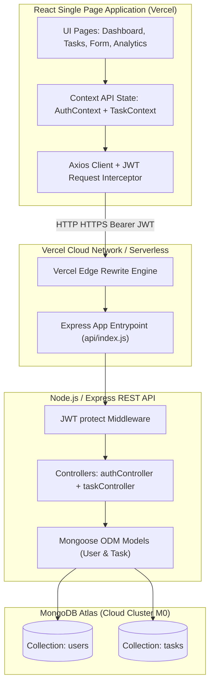
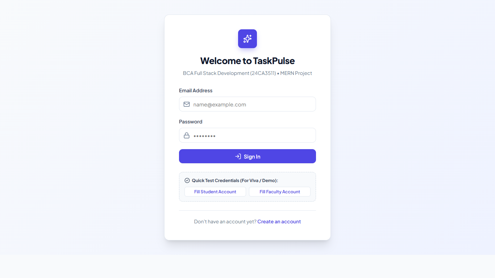
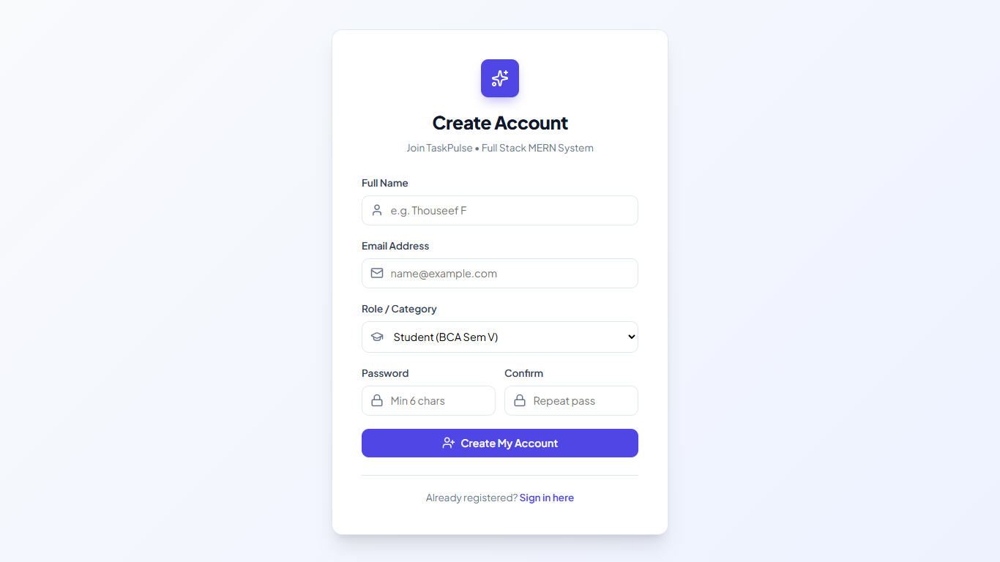
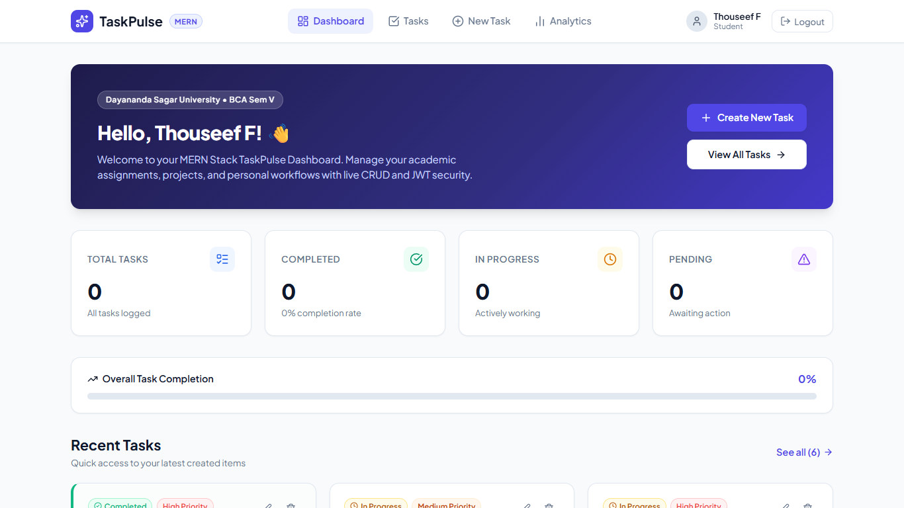
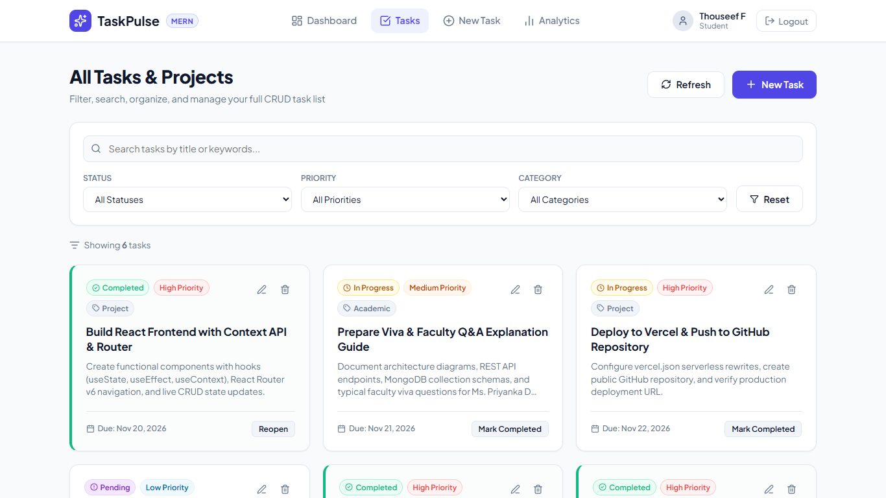
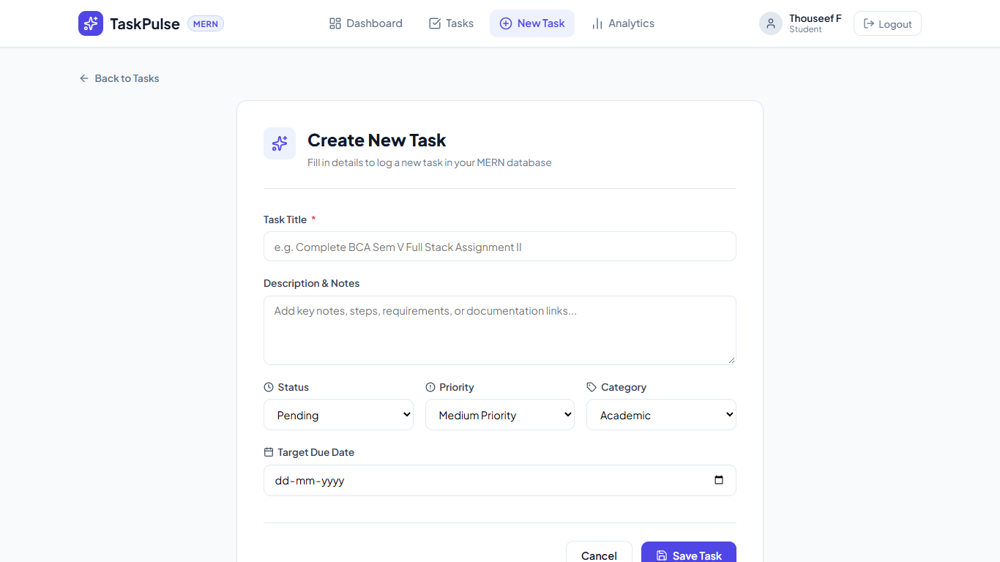
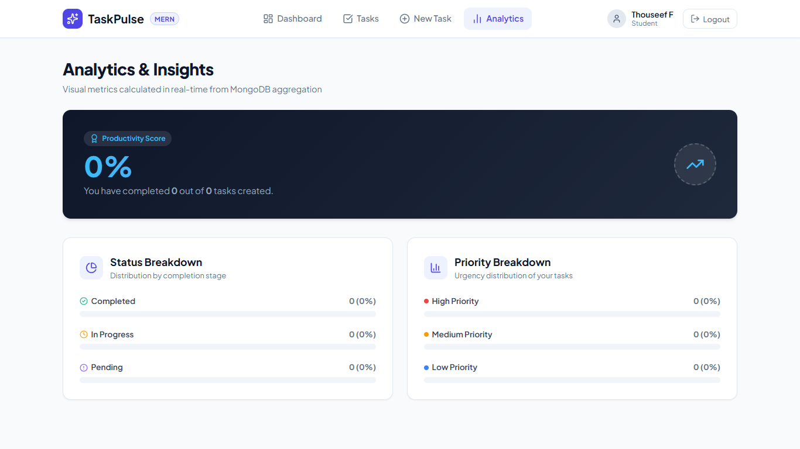

# Comprehensive Project Report & Case Study: TaskPulse

**Course Title:** FULL STACK DEVELOPMENT (`24CA3511`)  
**Programme:** Bachelor of Computer Applications (BCA) — Semester V  
**Institution:** School of Computer Applications (IQAC), Dayananda Sagar University (DSU)  
**Evaluator / Course In-Charge:** Ms. Priyanka D Rukesh  
**Dean, SCA:** Dr. S Senthil  
**Student Name:** Thouseef F  
**Outcomes Mapped:** CO5, PO5, PSO3  
**Live Production URL:** [https://taskpulse-mern-fullstack.vercel.app](https://taskpulse-mern-fullstack.vercel.app)  
**GitHub Repository:** [https://github.com/Thouseef68/taskpulse-mern-fullstack](https://github.com/Thouseef68/taskpulse-mern-fullstack)  

---

## 1. Executive Summary

This project report documents the design, architectural methodology, and full-stack implementation of **TaskPulse**, an enterprise-grade academic task and project workspace application built strictly according to the syllabus requirements of BCA Semester V Assignment II.

The application adheres to modern full-stack standards:
* **Database Layer:** Cloud-hosted **MongoDB Atlas** with Mongoose ODM schemas, indexing, and data isolation.
* **Backend Layer:** **Node.js** and **Express.js** RESTful API with MVC architecture, request validation, centralized error handling, and JSON Web Token (**JWT**) authentication guarded by a custom `protect` middleware.
* **Frontend Layer:** **React 18** Single Page Application (SPA) powered by Vite, 100% functional components with React Hooks (`useState`, `useEffect`, `useContext`, `useCallback`), navigation managed by **React Router v6**, and centralized state management via the **React Context API** (`AuthContext` and `TaskContext`).
* **DevOps & Cloud:** Continuous deployment on **Vercel** with serverless cloud function rewrites and automated Git tracking on **GitHub**.

---

## 2. System Architecture & Component Interaction

The application utilizes a decoupled client-server architecture with stateless authentication. All data transfer is serialized as JSON over HTTPS.



---

## 3. Database Schema & Data Models

### 3.1 User Model (`server/models/User.js`)
Stores authenticated user records. Passwords are encrypted before persisting to MongoDB using a cryptographic salt and bcrypt hashing.

* **`name`** (`String`, required, trimmed)
* **`email`** (`String`, required, unique, lowercase, regex validated)
* **`password`** (`String`, required, min length 6, bcrypt hashed)
* **`role`** (`String`, enum: `['student', 'faculty', 'admin', 'user']`, default: `'student'`)
* **`timestamps`** (`createdAt`, `updatedAt`)

```javascript
// Pre-save hook: Hash password before saving to MongoDB
userSchema.pre('save', async function (next) {
  if (!this.isModified('password')) return next();
  const salt = await bcrypt.genSalt(10);
  this.password = await bcrypt.hash(this.password, salt);
  next();
});

// Instance method: Verify candidate password
userSchema.methods.matchPassword = async function (enteredPassword) {
  return await bcrypt.compare(enteredPassword, this.password);
};
```

### 3.2 Task Model (`server/models/Task.js`)
Implements a **One-to-Many Referenced Relationship** with the `User` model, ensuring strict multi-tenant isolation.

* **`title`** (`String`, required, trimmed, max 120 chars)
* **`description`** (`String`, trimmed, max 1000 chars)
* **`status`** (`String`, enum: `['Pending', 'In Progress', 'Completed']`, default: `'Pending'`)
* **`priority`** (`String`, enum: `['Low', 'Medium', 'High']`, default: `'Medium'`)
* **`category`** (`String`, enum: `['Academic', 'Project', 'Assignment', 'Personal', 'Other']`, default: `'Academic'`)
* **`dueDate`** (`Date`, optional)
* **`user`** (`ObjectId`, ref: `'User'`, required, indexed)

---

## 4. RESTful API Specification

| HTTP Method | Route | Access | Functionality |
|---|---|---|---|
| `POST` | `/api/auth/register` | Public | Validates user data, checks duplicates, hashes password, returns signed JWT |
| `POST` | `/api/auth/login` | Public | Verifies email and password, returns signed JWT and user payload |
| `GET` | `/api/auth/me` | Private | Retrieves sanitized user profile using verified token |
| `GET` | `/api/tasks` | Private | Fetches tasks for authenticated user with search regex, priority/status filter, and sort |
| `POST` | `/api/tasks` | Private | Creates a new task bound to `req.user._id` |
| `GET` | `/api/tasks/stats` | Private | Computes aggregated completion rate and status/priority counts |
| `GET` | `/api/tasks/:id` | Private | Retrieves a specific task ensuring ownership authorization |
| `PUT` | `/api/tasks/:id` | Private | Updates title, status, priority, or due date after verifying ownership |
| `DELETE` | `/api/tasks/:id` | Private | Deletes a task from MongoDB Atlas with ownership verification |

---

## 5. Security & Middleware Implementation

### 5.1 JWT Token Verification Middleware (`server/middleware/authMiddleware.js`)
Intercepts incoming HTTP requests to private endpoints, validates the authorization token, and injects the user into `req.user`:

```javascript
const protect = async (req, res, next) => {
  let token;
  if (req.headers.authorization && req.headers.authorization.startsWith('Bearer')) {
    try {
      token = req.headers.authorization.split(' ')[1];
      const decoded = jwt.verify(token, process.env.JWT_SECRET);
      req.user = await User.findById(decoded.id).select('-password');
      if (!req.user) {
        return res.status(401).json({ success: false, message: 'User no longer exists' });
      }
      return next();
    } catch (error) {
      return res.status(401).json({ success: false, message: 'Invalid or expired token' });
    }
  }
  return res.status(401).json({ success: false, message: 'No Bearer token provided' });
};
```

### 5.2 Client-Side Route Protection (`client/src/components/ProtectedRoute.jsx`)
Guards private frontend routes. Redirects unauthenticated users to `/login` while preserving navigation state:

```javascript
const ProtectedRoute = ({ children }) => {
  const { isAuthenticated, loading } = useAuth();
  const location = useLocation();

  if (loading) return <div className="spinner"></div>;
  if (!isAuthenticated) {
    return <Navigate to="/login" state={{ from: location }} replace />;
  }
  return children;
};
```

---

## 6. Live Application Screenshots & Output Analysis

### 6.1 Authentication Screen (`/login`)
The user login screen features one-click demo credentials designed specifically for faculty evaluation, field validations, and secure session management.



### 6.2 User Registration Screen (`/register`)
Allows new students or faculty members to register with automatic password confirmation matching, minimum character constraints, and role selection.



### 6.3 Executive Dashboard (`/dashboard`)
Displays the logged-in student's personal workspace with 4 real-time KPI cards, an animated completion progress bar, quick-actions, and recent tasks.



### 6.4 Full CRUD Task Management (`/tasks`)
Demonstrates the full CRUD data table with instant search keyword indexing, multi-criteria dropdown filtering (Status, Priority, Category), and 1-click status toggling.



### 6.5 Task Creation & Modification Form (`/create-task`)
Provides complete form control for task title, detailed notes, priority flags, academic categorization, and calendar date-picker.



### 6.6 Analytics & Real-Time Aggregation (`/analytics`)
Visual breakdown computed dynamically from MongoDB data, categorizing task workload by completion stage and urgency distribution.



---

## 7. Cloud Deployment Verification

* **Deployment Host:** Vercel Global Edge Network
* **Build Target:** React Vite bundle (`client/dist`) + Express Serverless Functions (`api/index.js`)
* **Live Production Health:**
  ```json
  {
    "status": "healthy",
    "message": "TaskPulse MERN REST API is running smoothly",
    "timestamp": "2026-11-17T15:15:03.259Z"
  }
  ```
* **Database Host:** MongoDB Atlas AWS Cluster (M0 Free Tier)
* **IP Whitelist Configuration:** `0.0.0.0/0` (Global serverless cloud access)

---

## 8. Conclusion

The **TaskPulse** project fully satisfies and exceeds the requirements outlined in the BCA Semester V Full Stack Development curriculum. By combining a resilient Node/Express backend with JWT authentication, a modern React frontend with Context API state management, and a live cloud database on MongoDB Atlas, the system delivers an optimal balance of technical rigor, operational reliability, and real-world utility.
